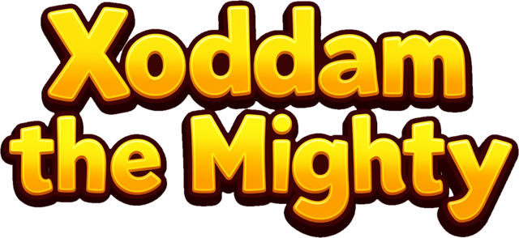
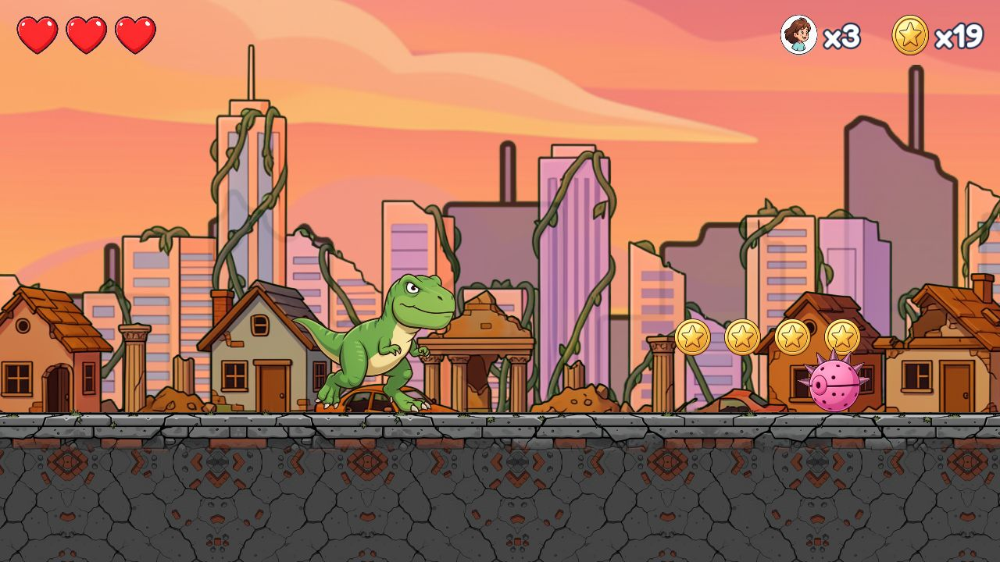
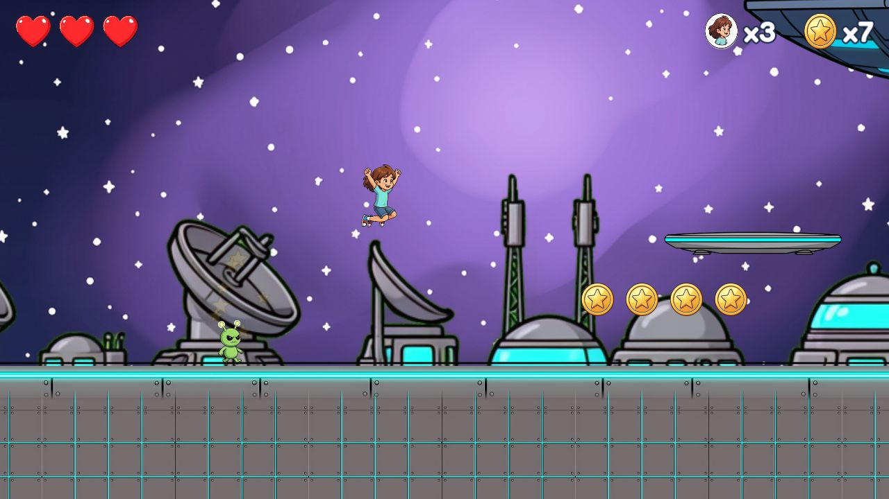
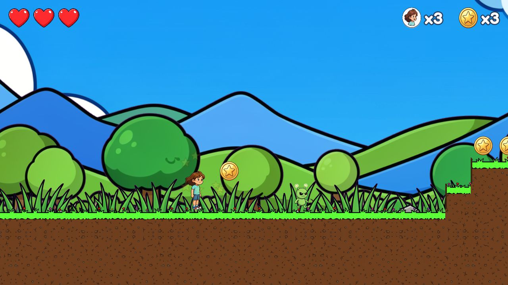
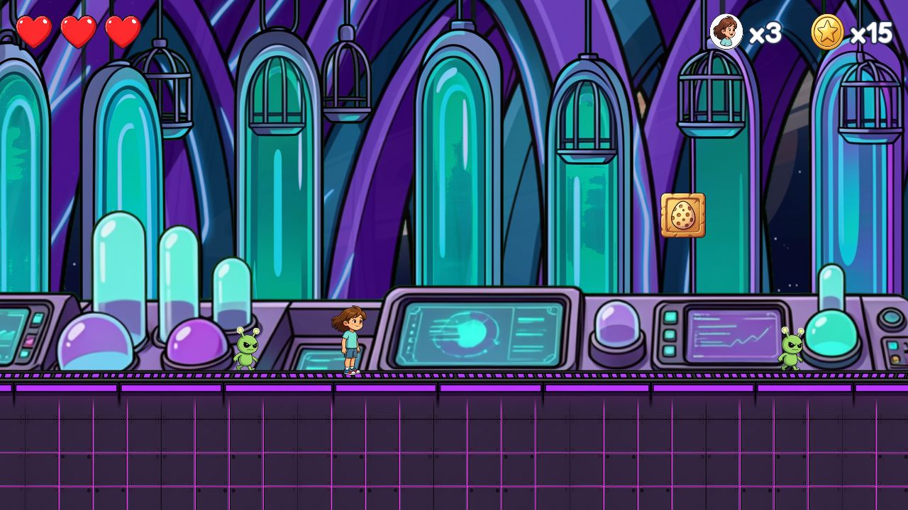

<p align="center">
  
</p>

A free side-scrolling platformer for kids, made with [Godot](https://godotengine.org/) 4.7. Aliens have taken the
puppies. A boy runs and jumps through four levels, squashes alien robots, grabs a T-Rex egg to turn into a mighty
T-Rex, and frees a caged puppy at the end of each level.

**Play it in your browser: [xoddam.com](https://xoddam.com/)** (phone, tablet or computer; turn a phone sideways).

<p align="center">
  
  
  
  
</p>

## How it plays

| | Keyboard | Touch |
|---|---|---|
| Move | Arrow keys or A / D | left and right buttons |
| Jump | Space, Up arrow or W | the big button |
| Pause | Esc | the pause button |

- **Stomp** aliens by landing on them. Touching one from the side costs a heart (you have 3 hearts and 3 lives).
- **Bump the `?` block** from below to get an egg. Grab it to become a **T-Rex**: bigger, can take one hit, and
  defeats small aliens just by touching them.
- **Coins:** every 20 refill your hearts, every 50 give an extra life.
- **Saving is automatic** (when a level starts or ends). The title screen's Continue picks it up.

## Run it from source

You need [Godot 4.7.2](https://godotengine.org/download/) (the standard build, not .NET). The project uses the
Compatibility renderer.

1. Open `project.godot` in Godot, then press F5. The main scene is the title screen.
2. In a debug run the title screen also has **Debug Level Select**, and in a level these keys work:
   `1` `2` `3` warp, `I` invincible, `T` boy / T-Rex, `H` heal.

The Python scripts in `tools/` only make art and sound files (`pip install -r requirements.txt`). The game does not
need them. Settings for the tools and the website deploy go in a `.env` file (copy `.env.example`; git ignores it).

## Tests

Godot has no unit-test framework, so `tests/run_tests.gd` is a plain script that Godot runs from the command line
(about 350 checks, 20 seconds, exit code 1 if anything fails):

Linux or Mac (with `godot` on your PATH):

```bash
godot --headless --path . --script res://tests/run_tests.gd
```

Windows PowerShell (put the path of your Godot console exe in a variable, once per window):

```powershell
$godot = "C:\path\to\Godot_v4.7.2-stable_win64_console.exe"
& $godot --headless --path . --script res://tests/run_tests.gd
```

Run these from the project folder. More in [tests/README.md](tests/README.md).

## Project layout

| Folder | What is in it |
|---|---|
| `scripts/` | all game code (GDScript) |
| `scenes/` | the player, the enemies, the four level scenes, the menus |
| `levels/` | each level is a plain-text map ([how to edit](levels/README.md)) |
| `art/` | pictures the game uses; `art/concepts/` holds the generated concept art they came from |
| `audio/` | music and sound effects (free placeholder files) |
| `assets/fonts/` | the Fredoka font |
| `tools/` | Python and GDScript helpers for making art and sound, and an auto-play bot |
| `tests/` | the test script |
| `site/` | the xoddam.com website (Astro) and its deploy script |
| `docs/` | the documents listed below |

## Documents

- [docs/ARCHITECTURE.md](docs/ARCHITECTURE.md): how the code fits together, and where to change things
- [levels/README.md](levels/README.md): the level map format and every enemy
- [docs/web-build.md](docs/web-build.md): export the game for the browser, install it from the browser, and the sound pitfalls
- [docs/android-build.md](docs/android-build.md): build the Android app (an APK), sign it and put it on the website
- [site/README.md](site/README.md) and [docs/hosting.md](docs/hosting.md): the website and how it is hosted
- [docs/art-bible.md](docs/art-bible.md): the look of the game
- [docs/PLAN.md](docs/PLAN.md): the original plan
- [CHANGELOG.md](CHANGELOG.md): what changed, in plain words
- [CREDITS.md](CREDITS.md): third-party assets and their licences

## Status

Playable from start to finish: four levels, 13 kinds of enemy, two bosses, music and sound effects, and a website
with the game on it. It has been tried in desktop and iPhone browsers. It can be installed from the browser's
"Add to Home screen", and an Android app (APK) can be built and downloaded from the website; neither has been tried on
a real Android tablet yet.

## Credits and licence

Credits are in [CREDITS.md](CREDITS.md). The pictures were made with AI image tools, then cut out and tuned by hand
and by script. Music and sound effects are free (CC0) files, and the font is open source.

The code is under the [MIT licence](LICENSE). The pictures, logo and other artwork are not covered by it: no licence
has been chosen for them yet, so all rights to them are reserved. Third-party files keep their own licences (see
CREDITS.md).
